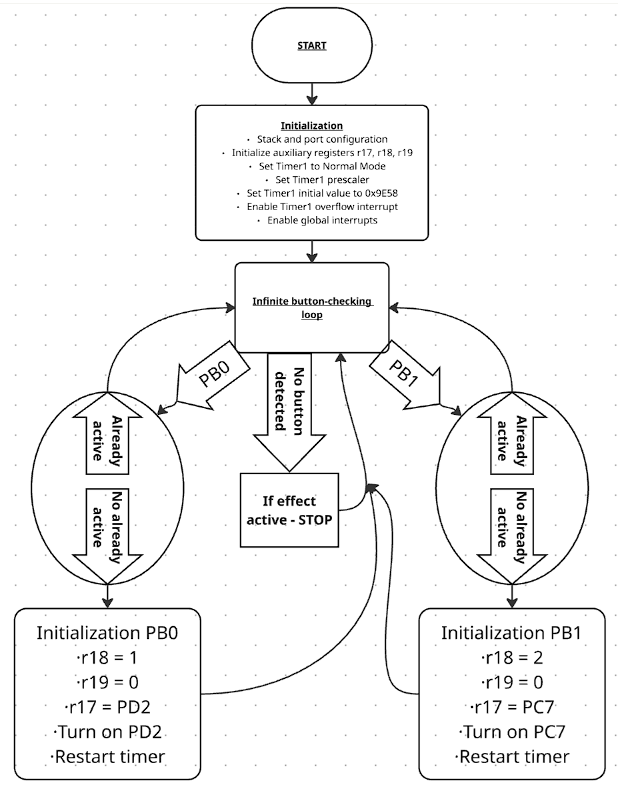
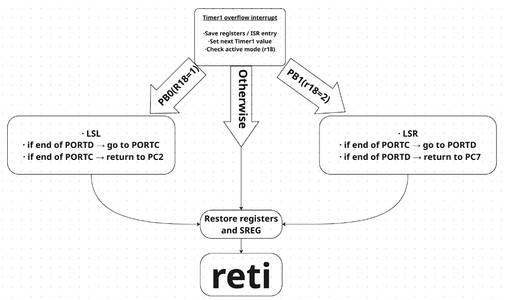
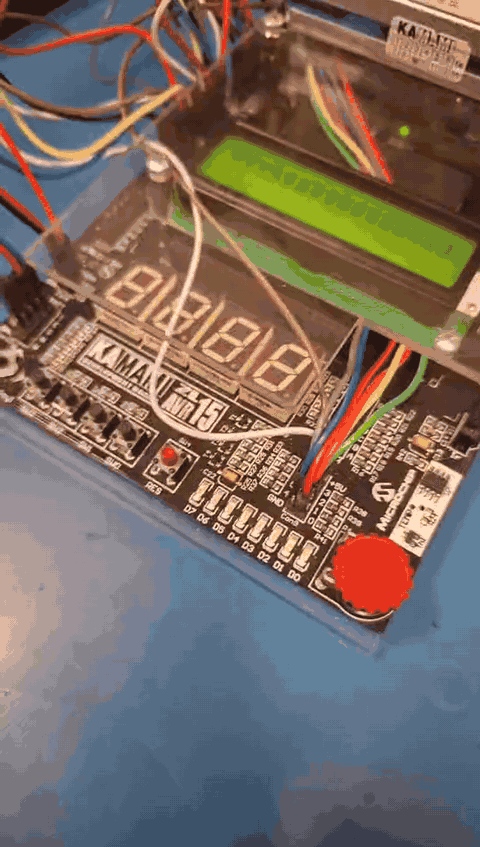

# ATmega32A LED Snake

Simple AVR Assembly project for the ATmega32A.

## Features

- LED snake effect using LEDs connected to `PD2–PD7` and `PC6–PC7`
- Push button `PB0` – movement in one direction
- Push button `PB1` – movement in the opposite direction
- Timer1 overflow interrupt
- Approx. 100 ms between LED transitions

## Hardware

- ATmega32A
- ZL15AVR development board
- LEDs: `PD2–PD7`, `PC6–PC7`
- Buttons: `PB0`, `PB1`

## Flowcharts

### Main program

### Timer1 interrupt

## Demo

## Notes

Created as part of a university AVR laboratory exercise.

AI assistance was used for explanations, code review and refactoring.
